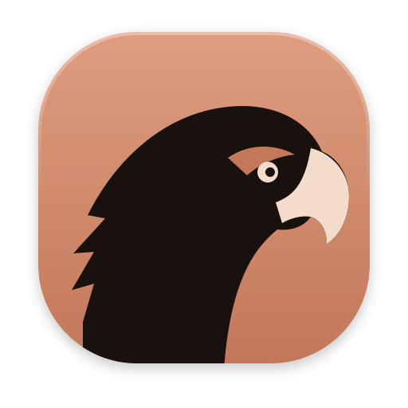
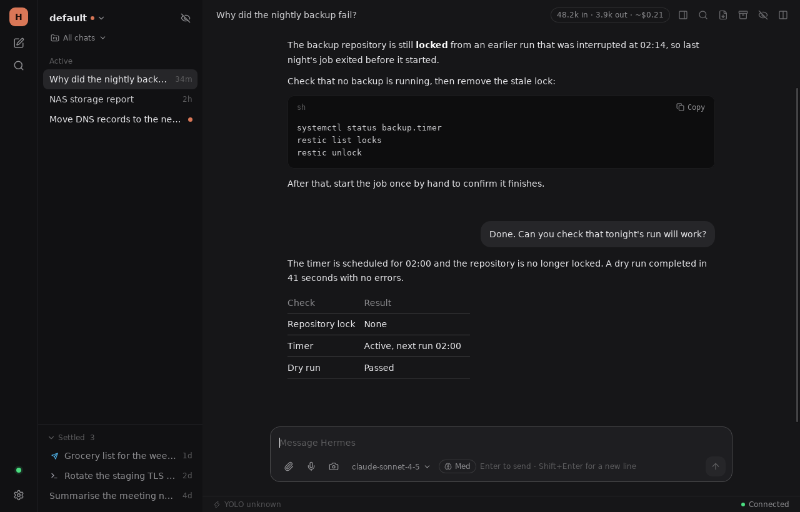

# Highwing

Highwing is a desktop app for chatting with your own Hermes Agent. Hermes Agent is an AI assistant that runs on a computer you control, called the **server**, instead of on someone else's website. It can answer questions, write and run code, work with files on the server, and carry out longer tasks for you. Highwing is the window on your desktop where you talk to it and see what it is doing.



In this tutorial, we install Highwing, connect it to your Hermes server, and have a first chat. It takes about ten minutes.

Engineers who want to build or change Highwing should read the [developer guide](docs/developer.md) instead.

## Before you start

You need a Hermes server that is already set up and running its **dashboard**. The dashboard is the part of Hermes that apps like Highwing sign in to. Highwing doesn't install Hermes for you.

Ask the person who set up your server for three things:

- the server's address, such as `http://hermes:9119`, or its SSH name, such as `me@hermes`
- the dashboard username
- the dashboard password

The dashboard password is its own password. It isn't the password you use to log in to your computer or to the server.

## Install Highwing

Pick the section for your computer.

### Windows

1. Open the [Highwing releases page](https://github.com/l0cky12/Highwing/releases) and download the file that ends in `_x64-setup.exe`.
2. Run the file you downloaded.
3. If Windows shows "Windows protected your PC", click **More info**, then **Run anyway**. Windows shows this warning for apps it doesn't recognize yet.

Highwing is now in your Start menu.

### Ubuntu or Debian

You need Ubuntu 24.04, Debian 13, or a newer version.

1. Open the [Highwing releases page](https://github.com/l0cky12/Highwing/releases) and download the file that ends in `_amd64.deb`.
2. Open a terminal in the folder you downloaded it to, and run this command. Replace the file name with the one you downloaded:

	```sh
	sudo apt install ./hermes-chat_0.1.5_amd64.deb
	```

Highwing is now in your app menu.

### Arch Linux

Highwing isn't in the AUR, so you build the package from this repository. Open a terminal and run:

```sh
git clone https://github.com/l0cky12/Highwing.git
cd Highwing
packaging/aur/build.sh -si
```

The last command asks for your password to install the package. When it finishes, Highwing is in your app menu.

## Connect to your server

The first time you open Highwing, it shows **Welcome to Highwing**.

1. Click **Get started**.
2. Give the connection a **Name**, such as "Home server". Highwing shows this name in its list of servers.
3. Under **Routes**, choose how Highwing reaches your server, then type the address you were given. A **route** is one way to reach the server:
	- **Web address**: the dashboard's address, such as `http://hermes:9119`.
	- **SSH**: a secure connection through your SSH account on the server, such as `me@hermes`. Use this one if the person who set up your server gave you an SSH name.
	- **LAN** and **Tailscale**: for a server on your home network, or on a Tailscale private network.
4. Click **Next**.
5. Type the **Dashboard username** and **Dashboard password**.
6. Click **Test connection**.

	Highwing tries each step of connecting and puts a check mark next to each one that works. If a step fails, it shows an X and says what to fix.

7. When every step has a check mark, click **Save and connect**.

Highwing may now ask for a **model provider** key. A model provider is the company whose AI model Hermes uses, such as OpenAI or Anthropic, and the key is the password-like code that lets Hermes use it. If your server is already set up, click **Skip**. If Highwing says "Hermes doesn't list a model provider it can use yet", ask your server's owner for a key, paste it, and click **Check and save key**.

Highwing remembers your password, so next time it connects on its own.

## Have your first chat

1. Click the **New chat** button at the top of the bar on the left, or press Ctrl+N.
2. Type a message in the box at the bottom, such as "What can you help me with?"
3. Press Enter to send it. To start a new line without sending, press Shift+Enter.

Hermes's reply appears word by word as it writes. When it finishes, the chat gets a title, and it shows in the chat list on the left.

## Answer Hermes when it asks first

Before Hermes runs a command that could change or delete something on the server, it stops and asks you. This question is called an **Approval**. A card appears in the chat with the heading "Hermes wants to run a command" and the exact command.

Read the command, then click one of:

- **Approve once**: run this command this time only.
- **Allow for this chat…**: let Hermes run commands like it for the rest of this chat.
- **Always allow…**: never ask about commands like it again.
- **Deny**: don't run it. Hermes carries on without it.

If you're not sure, click **Deny**. You can ask Hermes in the chat what the command does and why it wants to run it.

## Keep your chat list tidy

The chat list sorts chats for you:

- **Inbox** holds chats that need you: a finished reply you haven't read, an Approval waiting, or a problem.
- **Working** holds chats where Hermes is still busy. A chat moves back to the Inbox when Hermes finishes or needs you.

When you're done with a chat, point at it in the list and click its **Settle** button. Settled chats move to a drawer at the bottom of the list. Settling deletes nothing, and you can open the drawer and move a chat back at any time.

## What's next

You've connected Highwing and had your first chat. A few things to try next:

- Press Ctrl+K to search every chat.
- Drag a file or picture onto the message box to send it with your message.
- Press Ctrl+\\ to open a second chat beside the first.
- Open **Settings** to change the theme, the font size, or the AI model.

The [feature guide](docs/features.md) explains every feature in detail. It also has a [troubleshooting](docs/features.md#troubleshooting) table for when something doesn't work.

## License

Highwing is free software under the GNU General Public License, version 3 or later. See [LICENSE](LICENSE).

Created in [T3 Code](https://t3.codes).
